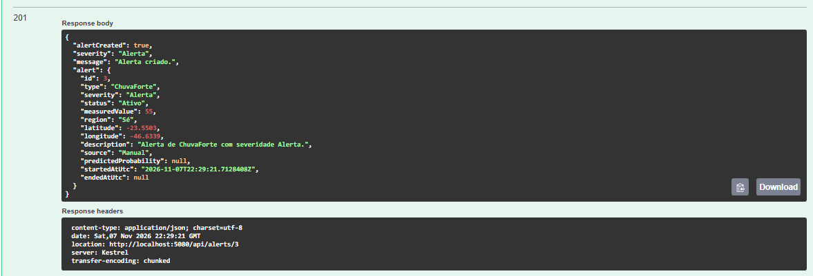
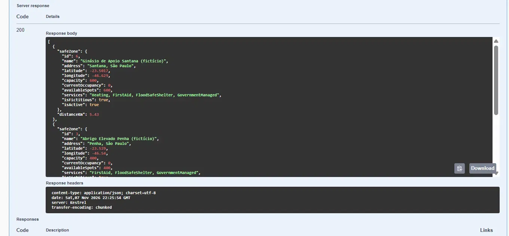

# Evidências de funcionamento

Capturas de tela da aplicação em execução. Para reproduzir, siga o passo a passo do [README](../README.md) e use o Swagger em `http://localhost:5080/swagger` (exemplos prontos em [`requests.http`](../requests.http)).

## 1. Documentação dos endpoints (Swagger)

## 2. Alerta criado: medição de 55 mm de chuva acima do limiar (`POST /api/alerts` → 201)

## 3. Medição abaixo do limiar: nenhum alerta é criado (`POST /api/alerts` → 200)

## 4. Pontos de segurança mais próximos do alerta (`GET /api/alerts/{id}/safe-zones` → 200)

## 5. Testes unitários (`dotnet test`: 53 aprovados, 0 falhas)

